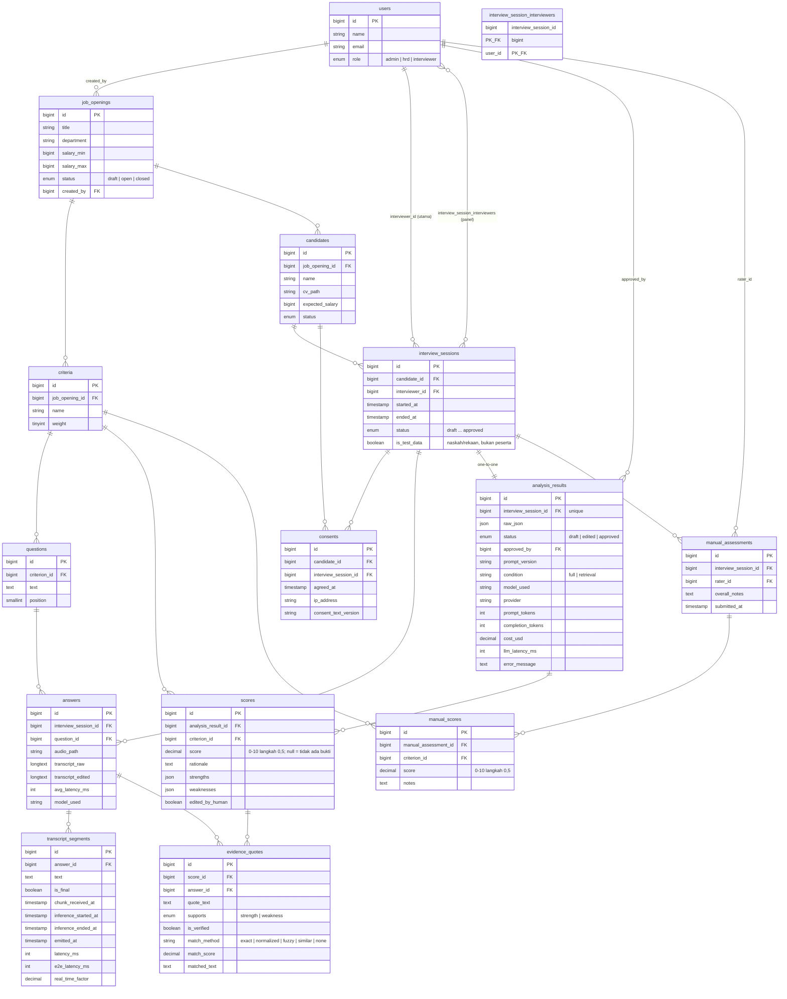

# ERD HireNote

Diturunkan dari `web/database/migrations/`. Perbarui setiap ada perubahan skema.

## Jenis relasi yang terwakili

| Jenis | Contoh | Di kode |
|---|---|---|
| One-to-many | `job_openings → criteria`, `answers → transcript_segments`, `manual_assessments → manual_scores` | `hasMany` / `belongsTo` |
| One-to-one | `interview_sessions → analysis_results` | `hasOne` + kolom unik |
| Many-to-many | `interview_sessions ↔ users` (panel) | `belongsToMany` via `interview_session_interviewers` |
| Has-many-through | `job_openings → questions` (lewat `criteria`), `analysis_results → evidence_quotes` (lewat `scores`) | `hasManyThrough` |
| Rantai bersarang 4 tingkat | `job_openings → criteria → questions → answers → transcript_segments` | eager load `criteria.questions` |
